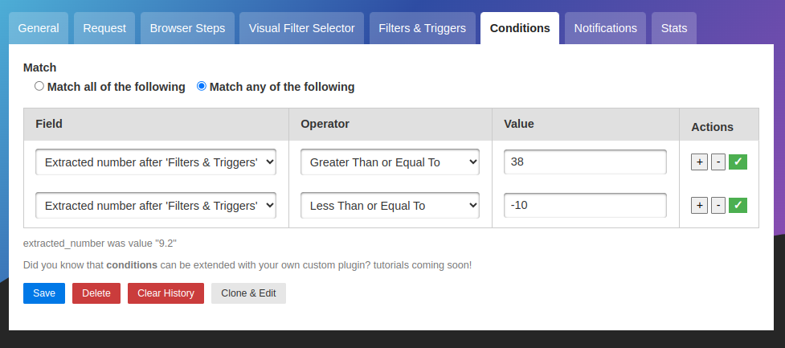
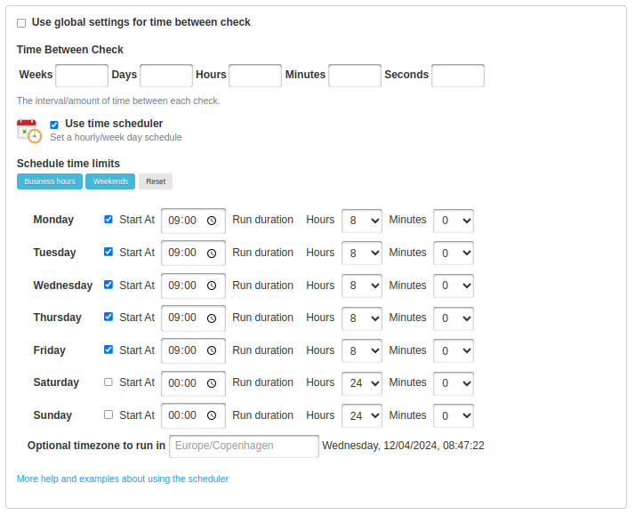
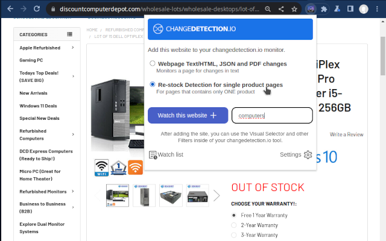

# Detect Website Changes Automatically — Monitor Web Page Changes in Real Time

Monitor websites for updates — get notified via Discord, Email, Slack, Telegram, Webhook and many more.

**Detect web page content changes and get instant alerts.**  

Ideal for monitoring price changes, content edits, conditional changes and more.

[![Release Version][release-shield]][release-link] [![Docker Pulls][docker-pulls]][docker-link] [![License][license-shield]](LICENSE.md)

[**Get started with website page change monitoring straight away. Don't have time? Try our $8.99/month subscription, use our proxies and support!**](https://changedetection.io) , _half the price of other website change monitoring services!_

- Chrome browser included.
- Nothing to install, access via browser login after signup.
- Super fast, no registration needed setup.
- Get started watching and receiving website change notifications straight away.
- See our [tutorials and how-to page for more inspiration](https://changedetection.io/tutorials) 

## AI-powered website change detection — smart alerts and plain-language summaries

Stop drowning in noise. Connect any LLM (OpenAI, Gemini, Anthropic, Ollama and more) and go from _"something changed"_ to _"only the thing you care about changed"_.

### Example use cases

- Products and services have a change in pricing
- _Out of stock notification_ and _Back In stock notification_
- Monitor and track PDF file changes, know when a PDF file has text changes.
- Governmental department updates (changes are often only on their websites)
- New software releases, security advisories when you're not on their mailing list.
- Festivals with changes
- Discogs restock alerts and monitoring
- Realestate listing changes
- Know when your favourite whiskey is on sale, or other special deals are announced before anyone else
- COVID related news from government websites
- University/organisation news from their website
- Detect and monitor changes in JSON API responses 
- JSON API monitoring and alerting
- Changes in legal and other documents
- Trigger API calls via notifications when text appears on a website
- Glue together APIs using the JSON filter and JSON notifications
- Create RSS feeds based on changes in web content
- Monitor HTML source code for unexpected changes, strengthen your PCI compliance
- You have a very sensitive list of URLs to watch and you do _not_ want to use the paid alternatives. (Remember, _you_ are the product)
- Get notified when certain keywords appear in Twitter search results
- Proactively search for jobs, get notified when companies update their careers page, search job portals for keywords.
- Get alerts when new job positions are open on Bamboo HR and other job platforms
- Website defacement monitoring
- Pokémon Card Restock Tracker / Pokémon TCG Tracker
- RegTech - stay ahead of regulatory changes, regulatory compliance

_Need an actual Chrome runner with Javascript support? We support fetching via WebDriver and Playwright!</a>_

#### Key Features

- Lots of trigger filters, such as "Trigger on text", "Remove text by selector", "Ignore text", "Extract text", also using regular-expressions!
- Target elements with xPath 1 and xPath 2, CSS Selectors, Easily monitor complex JSON with JSONPath or jq
- Switch between fast non-JS and Chrome JS based "fetchers"
- Track changes in PDF files (Monitor text changed in the PDF, Also monitor PDF filesize and checksums)
- Easily specify how often a site should be checked
- Execute JS before extracting text (Good for logging in, see examples in the UI!)
- Override Request Headers, Specify `POST` or `GET` and other methods
- Use the "Visual Selector" to help target specific elements
- Configurable [proxy per watch](https://github.com/dgtlmoon/changedetection.io/wiki/Proxy-configuration)
- Send a screenshot with the notification when a change is detected in the web page

We [recommend and use Bright Data](https://brightdata.grsm.io/n0r16zf7eivq) global proxy services, Bright Data will match any first deposit up to $150 using our signup link.

Please :star: star :star: this project and help it grow! https://github.com/dgtlmoon/changedetection.io/

### Conditional web page changes

Easily [configure conditional actions](https://changedetection.io/tutorial/conditional-actions-web-page-changes), for example, only trigger when a price is above or below a preset amount, or [when a web page includes (or does not include) a keyword](https://changedetection.io/tutorial/how-monitor-keywords-any-website)

### Schedule web page watches in any timezone, limit by day of week and time.

Easily set a re-check schedule, for example you could limit the web page change detection to only operate during business hours.
Or perhaps based on a foreign timezone (for example, you want to check for the latest news-headlines in a foreign country at 0900 AM),

Includes quick short-cut buttons to setup a schedule for **business hours only**, or **weekends**.

### We have a Chrome extension!

Easily add the current web page to your changedetection.io tool, simply install the extension and click "Sync" to connect it to your existing changedetection.io install.

[Goto the Chrome Webstore to download the extension.](https://chromewebstore.google.com/detail/changedetectionio-website/kefcfmgmlhmankjmnbijimhofdjekbop) ( Or check out the [GitHub repo](https://github.com/dgtlmoon/changedetection.io-browser-extension) ) 

## Installation

### Docker

With Docker composer, just clone this repository and..

